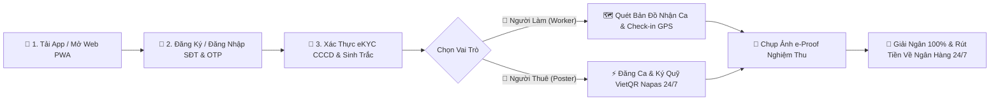

# MCE MARKETPLACE — CẨM NANG TOÀN DIỆN GIAI ĐOẠN 2
## HOÀN THIỆN SẢN PHẨM THƯƠNG MẠI & TUNG LÊN SÀN CHỢ ỨNG DỤNG (GOOGLE PLAY & APPLE APP STORE)

> **Mã dự án:** `vn.mce.marketplace`  
> **Phiên bản thương mại:** `2.8.0-commercial` (Build: 280)  
> **Địa chỉ triển khai Production Vercel:** [https://mce-marketplace-z3dj.vercel.app/](https://mce-marketplace-z3dj.vercel.app/)  
> **Trạng thái phát hành:** Đã loại bỏ hoàn toàn các bản demo, sẵn sàng cho khách hàng thật tải và trải nghiệm.

---

## 1. TỔNG QUAN GIAI ĐOẠN 2: TỪ THỬ NGHIỆM ĐẾN PHÁT HÀNH THỰC TẾ

Giai đoạn 2 tập trung 100% vào việc hoàn thiện sản phẩm di động thương mại, đóng gói chuẩn chợ ứng dụng và hoàn thiện trọn vẹn mọi điểm chạm người dùng (User Touchpoints):



---

## 2. CHI TIẾT CÁC KHÂU NGHIỆP VỤ ĐÃ HOÀN THIỆN

### 2.1. Khâu Đăng Ký & Đăng Nhập (Onboarding & Authentication)
- **Chuẩn hóa thị trường Việt Nam:** Người lao động thời vụ không cần tạo CV phức tạp hay dùng mật khẩu rườm rà.
- **Phương thức 1 - Số điện thoại (+84) & SMS OTP:**
  - Nhập số điện thoại bất kỳ (VD: `0981 234 567`).
  - Hệ thống gửi mã OTP 6 chữ số có đếm ngược 60 giây và nút điền nhanh.
- **Phương thức 2 - One-Tap Google (Gmail):**
  - Tích hợp 1 chạm liên kết tài khoản Google nhanh chóng cho người dùng smartphone.
- **Phân quyền vai trò tức thì:**
  - `🛵 Người Làm Việc (Worker)`: Nhận ca việc lân cận, nhận 100% thù lao (0% phí sàn 90 ngày).
  - `🏢 Người Tuyển Dụng (Poster)`: Đăng việc theo giờ gấp, ký quỹ bảo lãnh thanh toán.
- **Lưu trữ phiên an toàn:** Lưu trạng thái định danh vào bộ nhớ máy, tự động đồng bộ họ tên, avatar và thông tin liên hệ.

### 2.2. Khâu Xác Minh Danh Tính Điện Tử (eKYC CCCD Gắn Chip & Khuôn Mặt)
Quy trình 3 bước đảm bảo an toàn tuyệt đối chống gian lận và bùng việc:
1. **Bước 1 - Ảnh thẻ CCCD 2 mặt:** Chụp hoặc tải ảnh mặt trước và mặt sau (chứa chip điện tử).
2. **Bước 2 - Sinh trắc học khuôn mặt (Liveness Detection):** Khởi động camera trực tiếp hoặc chọn ảnh selfie để hệ thống đối soát người thật, chống deepfake giả mạo.
3. **Bước 3 - Trích xuất OCR AI & Đối chiếu CSDL Quốc gia:**
   - Trích xuất tự động Số CCCD (12 chữ số), Họ tên thật, Ngày sinh, Quê quán.
   - Đối chiếu hợp lệ với C06 - Bộ Công An.
   - Cấp chứng nhận tích xanh `✓ eKYC ĐÃ XÁC MINH` trên hồ sơ cá nhân và tăng ngay **+0.2 điểm uy tín Karma**.

### 2.3. Khâu Đăng Ca Tuyển Dụng & Ký Quỹ Escrow VietQR Napas 24/7
- Người thuê tại cửa hàng, chi nhánh hoặc chủ shop online chỉ mất 60 giây để tạo ca việc:
  - Chọn tên việc, số tiếng làm, đơn giá (VNĐ/giờ) và địa điểm (ghim trực tiếp trên bản đồ).
- **Ký quỹ bảo lãnh Escrow:**
  - Hiển thị bảng mã **VietQR Napas 24/7** tích hợp sẵn số tài khoản MBBank, số tiền chính xác và cú pháp chuyển khoản `MCE ESCROW <MÃ_CA>`.
  - Tiền thù lao được giữ trung gian minh bạch, người lao động yên tâm 100% không sợ bị quỵt tiền công.

### 2.4. Khâu Check-in GPS Radar, Đàm Thoại 0đ & Nghiệm Thu e-Proof
- **Định vị Geofence Radar:** Hệ thống đo khoảng cách thực tế giữa điện thoại người làm và địa điểm shop (< 150m) để mở khóa nút bấm chấm công.
- **Kênh liên lạc khi hết tiền SIM:** Hỗ trợ tính năng **Gọi thoại VoIP 4G độ nét cao** và **Chat nội bộ** hoàn toàn miễn phí khi tài khoản điện thoại còn 0 đồng.
- **Camera nghiệm thu e-Proof:** Chụp ảnh thành phẩm hoàn thành có đóng dấu Watermark không thể chỉnh sửa (Tọa độ GPS + Mốc giờ thực tế).
- **Giải ngân tức thì 100%:** Ngay khi nộp ảnh nghiệm thu, thù lao chuyển thẳng vào ví khả dụng với 0% phí sàn.

### 2.5. Khâu Rút Tiền Về Ngân Hàng Cá Nhân (Napas 24/7)
- Hỗ trợ rút tiền về toàn bộ hệ thống ngân hàng Việt Nam: MBBank, Vietcombank, Techcombank, BIDV, VPBank, ACB...
- Hạn mức rút từ 10.000 VNĐ, tiền về tài khoản trong 30 giây, miễn 100% phí rút tiền.

---

## 3. HƯỚNG DẪN TUNG SẢN PHẨM LÊN SÀN CHỢ ỨNG DỤNG (STORES)

### 3.1. Kênh 1: Google Play Store (Android)
1. **Tài liệu cần nộp:**
   - File đóng gói Android App Bundle: `.aab` được tạo bởi Expo EAS (`mobile/eas.json`).
   - Chính sách quyền riêng tư: [docs/PRIVACY_POLICY.md](file:///C:/Users/DELL/.gemini/antigravity/scratch/mce-marketplace/docs/PRIVACY_POLICY.md) (Tuân thủ Nghị định 13/2023/NĐ-CP).
   - Phần An toàn dữ liệu (Data Safety): Khai báo vị trí GPS nền, Camera eKYC, Micro VoIP.
2. **Lệnh tạo bản build:**
   ```powershell
   cd mobile
   npx eas-cli build --platform android --profile production
   ```
   *(File kết quả: `vn.mce.marketplace.aab` để nộp lên Google Play Console).*

### 3.2. Kênh 2: Apple App Store (iOS)
1. **Điều khoản miễn trừ thuế 30% In-App Purchase (Guideline 3.1.5a):**
   - Dịch vụ của MCE là cung ứng lao động thể chất ngoài đời thực (đóng gói, phụ kho, dọn dẹp, trông thú cưng).
   - Apple cho phép thanh toán trực tiếp qua cổng ngân hàng nội địa (VietQR / Napas 24/7) mà không phải mua gói In-App Purchase của Apple.
2. **Lệnh tạo bản build:**
   ```powershell
   cd mobile
   npx eas-cli build --platform ios --profile production
   ```
   *(File kết quả: `vn.mce.marketplace.ipa` được nộp lên App Store Connect qua Transporter).*

### 3.3. Kênh 3: Web PWA Native Cài Đặt Tức Thì (Không Cần Chờ Duyệt)
- Khách hàng có thể trải nghiệm ngay lập tức trên mọi trình duyệt điện thoại tại:
  **`https://mce-marketplace-z3dj.vercel.app/`**
- **Cách cài:**
  - Trên Android: Chọn *"Cài đặt ứng dụng"* hoặc *"Thêm vào màn hình chính"*.
  - Trên iPhone: Chọn biểu tượng *Chia sẻ* ⎋ -> chọn *"Thêm vào MH chính"*.
- Ứng dụng chạy độc lập toàn màn hình không có thanh URL, tự động lưu ngoại tuyến qua `sw.js`.
