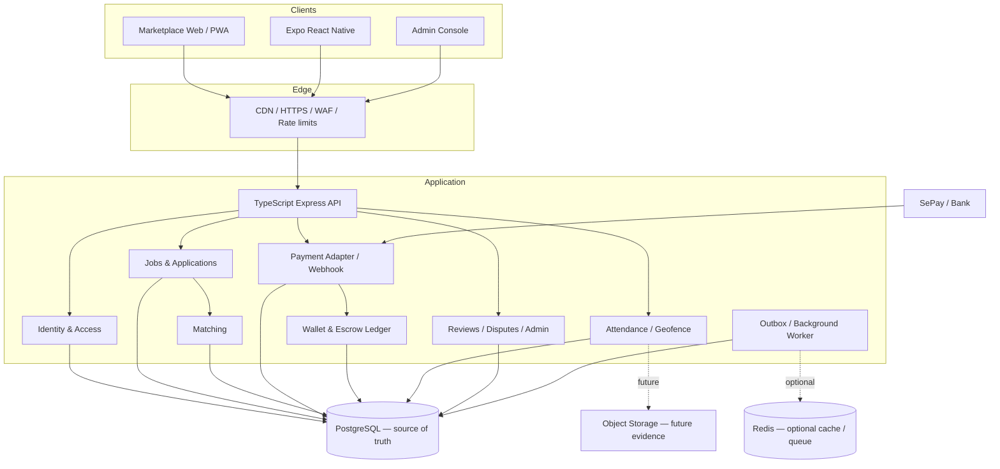

# MCE Marketplace — Architecture Blueprint

**Status:** Proposed target architecture; not a claim that every component is implemented.
**Baseline reviewed:** feat/marketplace-end-to-end at f5611eca88c6548a16a1f4725f88e5df4d9f18b8 (2026-11-26).
**Decision:** Keep a modular monolith. Do not split into microservices during the first 3-month launch cycle.

## 1. Product boundary

MCE is a hyperlocal, on-demand time marketplace connecting:
- **Poster:** creates a time-bounded job, funds its budget, selects a worker and approves completion.
- **Worker:** discovers jobs, applies, performs an assigned shift and requests completion review.
- **Operations/Admin:** handles support, moderation and payment reconciliation with an auditable trail.

The first commercial release should focus on one reliable end-to-end transaction. Withdrawals, automated KYC, automated dispute settlement, advanced anti-spoofing and multi-provider payment routing remain out of scope until the core pilot is stable.

## 2. Target logical architecture

## 3. Current components vs target

| Layer | Current evidence | Target / gap |
|---|---|---|
| Web client | index.html, public marketplace and static admin pages | Consolidate shared API contracts and remove duplicated demo behavior |
| Native client | Expo / React Native screens and API client | Keep native app as a separate client; verify Android/iOS runtime and permissions |
| API | Express + TypeScript, route and service modules | Keep as the only production API |
| Persistence | Prisma + PostgreSQL schema | PostgreSQL is the single source of truth |
| Payments | VietQR instruction generation + SePay HMAC webhook code | Require provider certification/sandbox tests and independent reconciliation |
| Wallet / escrow | PostgreSQL transactions and wallet rows | Replace current single-wallet transaction log with auditable double-entry journal before money at scale |
| Redis | Docker Compose service | Not a source of truth; do not operate unless cache/queue use is implemented and justified |
| Python / PowerShell | SQLite / JSON demo and local server paths | Local-only legacy fixtures; must not receive production traffic or hold live user data |
| Vercel | Commit checks report Vercel success | Treat as frontend deployment evidence only until API, database and runtime health are independently verified |

## 4. Module ownership and contracts

- **Identity:** registration, login, profile, session claims, role enforcement. Never accept role, KYC or phone-verification claims from public clients.
- **Jobs:** draft creation, budget calculation, job lifecycle state machine and discovery.
- **Applications / Matching:** application uniqueness, eligibility, matching score and one-worker assignment. Matching score is advisory, not an authorization decision.
- **Payments:** payment intent/reference creation, provider signature validation, event idempotency and bank reconciliation.
- **Ledger / Escrow:** immutable accounting entries, available/locked balances, lock/release/refund invariants and transaction boundaries.
- **Attendance:** server-side time window, coordinate bounds, GPS accuracy and geofence checks. Device GPS alone is not proof against spoofing.
- **Reviews:** one review per participant per completed job; only actual participants may review.
- **Disputes / Operations:** case creation, evidence retention, decision recording and separately authorized financial settlement.
- **Admin:** least-privilege access, mandatory audit events, pagination, sensitive-field minimization and two-person approval for exceptional financial actions.

Each module owns its business rules and database writes. Routes validate/authorize requests and delegate to services; services own transactions. Cross-module writes must be explicit and atomic where money or job state is involved.

## 5. Data and financial invariants

1. VND amounts are integer VND or Prisma Decimal with strict integer validation; never use binary floating-point for ledger arithmetic.
2. Every provider event is authenticated, uniquely identified and idempotent.
3. A job can become OPEN only after the exact server-calculated budget is funded and an escrow lock is committed.
4. One job can have at most one accepted worker.
5. A worker can check in/out only for their assigned job and in the allowed state/time/geofence.
6. Escrow release/refund is mutually exclusive and can happen at most once.
7. Ledger journal entries are append-only. Corrections use compensating entries, never editing historical money movement.
8. The sum of journal debits equals the sum of credits for every posted journal transaction.
9. Dispute resolution must not claim money has moved unless a settlement transaction has committed.
10. Admin state changes must preserve the same invariants as user actions and must be audited.

**Important current gap:** WalletTransaction is currently a per-wallet history with mutable balance columns, not a full double-entry accounting journal. The current implementation must not be treated as a regulated-grade financial ledger without additional controls and reconciliation.

## 6. Deployment topology

Recommended first production topology:
- Static web and admin assets behind HTTPS CDN (Vercel can remain if routing is configured correctly).
- TypeScript API as a separately deployed Node container/service with health and readiness endpoints.
- Managed PostgreSQL with private networking, encrypted storage, automated backups and point-in-time recovery.
- Redis only when a concrete cache/queue consumer exists; private network and authenticated access.
- Payment webhook exposed only through HTTPS, strict request-size limits, signature validation and monitoring.
- Secrets supplied by the hosting secret manager, never by committed Compose defaults.
- Separate development, staging and production projects/databases/credentials.
- One-off migration job with reviewed SQL and a backup/rollback plan before application rollout.

Do not assume Vercel deployment status proves the API container, PostgreSQL, webhook or native clients are healthy.

## 7. Security baseline

- Password hashes use a modern password-hashing algorithm and an appropriate work factor; generic login errors and rate limiting are required.
- JWT verification must include algorithm/issuer/audience policy and database-backed account status/role where immediate revocation is required.
- Apply route-level authorization, schema validation, body-size limits, CORS allowlists, security headers and rate limiting.
- Never log passwords, tokens, full identity numbers, bank account numbers or raw payment payloads without a documented retention and redaction policy.
- Keep database and Redis ports private; use non-default credentials and rotate any credential that was ever deployed from a public repository.
- Admin changes, KYC decisions, disputes and money movements require immutable audit records.
- Define data minimization, consent, retention and deletion processes before collecting identity documents.

## 8. Scalability strategy

**Now:** modular monolith, indexed PostgreSQL queries, bounded pagination, connection pooling, stateless API replicas, structured logs and basic metrics.

**After measured need:** Redis cache for read-heavy public discovery, queue/outbox for notifications and slow work, object storage for evidence, read replicas for analytics.

**Only after independent scaling pressure:** extract a module into a service. Do not introduce microservices, Kafka or Kubernetes before there is an operational need and a team to own them.

## 9. Architecture decisions still requiring owner approval

- Payment provider commercial account and live webhook activation.
- Legal/operational custody model for escrow-like funds and refund policy.
- KYC/SMS provider, consent and personal-data retention.
- Whether the local PowerShell server is retained as a developer demo or retired.
- Whether the current public sample data contains real personal information.
- Hosting provider, database region, backup retention and recovery objectives.

## 10. Acceptance criteria

- One authoritative production API and database.
- No production route uses local JSON, SQLite, in-memory repositories or hardcoded demo identities.
- Money state changes are atomic, idempotent, auditable and reconciled.
- Every job state transition is guarded by an explicit state machine.
- API and mobile/web clients share versioned request/response contracts.
- Staging can be rebuilt from source and migrations without manual data patching.
- Restore from backup is tested before public launch.

## Founder-approved decisions — 2026-11-26

- **Fee policy:** 0% (0 bps) for the launch period. New escrow records snapshot zero fee and 100% gross payout to the worker. Any future fee change requires a separate Founder approval and must not rewrite historical escrow.
- **Clients:** Web/PWA and Expo are both first-class clients. Both consume the same versioned TypeScript API and PostgreSQL domain services; business rules must not be duplicated in client code. The old mobile.html remains a legacy/demo artifact and is not a financial client.
- **Hosting:** managed Node.js application hosting and managed PostgreSQL are the target. Provider selection, secret provisioning, TLS, monitoring and production deployment remain explicit release tasks. Redis is not required until a measured workload justifies it.
- **Repository workflow:** finance hardening is developed on stacked feature branches and reviewed through PRs. Do not push directly to main.
